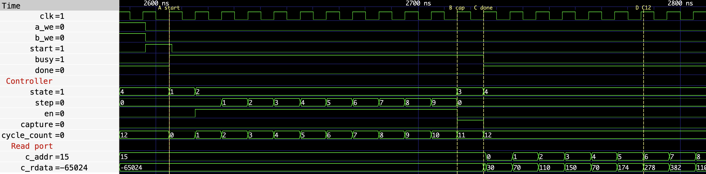

<div align="center">

# systolic-matmul-accelerator

**A 4×4 output-stationary systolic array for fixed-point matrix multiplication, in Verilog**

Modern Computer Architecture, Project 12: Systolic Array Matrix Multiplication Accelerator.

[](#results)
[](rtl/)
[](docs/setup.md)
[](docs/setup.md)

[Phase 1 report (PDF)](reports/phase1/main.pdf) · [Prototype video (4:42)](https://drive.google.com/drive/folders/1d-p1YpFjd7gjbm1XGEC8u5PCso8LQxUw?usp=sharing) · [Setup guide](docs/setup.md) · [Contributing](CONTRIBUTING.md)

</div>

## Idea

Matrix multiplication is the core operation of neural-network inference. A systolic array computes it with a grid of small processing elements (PEs) that each do one multiply-accumulate (MAC) per cycle. Operands pulse through the grid from neighbour to neighbour, so every value fetched from memory is reused across a whole row or column of PEs.

This project builds a parameterized N×N array (default 4×4) with an **output-stationary** dataflow:

- rows of **A** enter from the left and move right, skewed so row `i` starts `i` cycles late;
- columns of **B** enter from the top and move down, skewed so column `j` starts `j` cycles late;
- PE `(i, j)` keeps `C[i][j]` in its accumulator and adds `A[i][k] · B[k][j]` when the two operands meet.

For an N×N by N×N product, the array takes `3N − 2` compute cycles (10 for 4×4), plus one cycle to clear and one to capture the result: **12 busy cycles**. A single sequential MAC would need N³ = 64 compute cycles for the same product; that baseline is analytical. See [Results](#results) for the measured checks and the throughput calculation.

## Architecture diagrams



[All four diagrams, editable sources and SVG/PNG exports](docs/architecture/README.md)
cover the system, PE internals, 4×4 wavefront and controller states, following
[the architecture contract](docs/spec.md).

The host loads A and B through independent row-major write ports, pulses `start`
for one cycle, waits for `done`, and reads C through `c_addr` / `c_rdata`. The
controller sequences `IDLE → CLEAR → COMPUTE → CAPTURE → DONE`. Writes during
`busy` are ignored, and the previous C stays readable until the next capture.
Defaults are signed 8-bit operands, 32-bit accumulators, and `K = N = 4`; all
registers use `clk` and synchronous active-low `rst_n`.

## Status

| Component | Path | Issue | Status |
|---|---|---|---|
| Architecture spec and interface contract | `docs/spec.md` | #2 | Implemented |
| MAC unit and processing element | `rtl/pe/` | #6 | Implemented, self-checked |
| N×N array grid | `rtl/array/` | #3 | Implemented, N=4 and N=3 tested |
| Input skew buffers and output readout | `rtl/buffers/` | #10 | Implemented, self-checked |
| Controller FSM | `rtl/control/` | #7 | Implemented, self-checked |
| Top level and matrix data interface | `rtl/top/` | #4 | Integrated, self-checked |
| Python golden model and test vectors | `model/` | #14 | Implemented, model self-tests |
| End-to-end self-checking testbench | `tb/tb_systolic_top.v` | #11 | 106 golden cases pass |
| Synthesis, Fmax, resources, sequential RTL baseline | `synth/` | Phase 2 | Planned |

## Quick start

Install GNU Make, Icarus Verilog (`iverilog` / `vvp`), Verilator, Python 3.10+
and GTKWave or Surfer using the [platform-specific setup guide](docs/setup.md).
The viewer is needed only for `make waves`; lint and tests run without a GUI.

```sh
git clone --branch dev https://github.com/vks-g/systolic-matmul-accelerator.git
cd systolic-matmul-accelerator
python3 -m venv .venv
. .venv/bin/activate
python -m pip install -r model/requirements.txt
make lint
make test
```

Run from the repository root with `.venv` active. `make lint` checks all seven
RTL modules using Verilator `--lint-only -Wall`. `make test` generates 106 golden
cases (6 directed + 100 random, seed 1), compiles Verilog-2005 with Icarus, and
runs all seven self-checking testbenches. A mismatch, missing `PASS` summary,
compile error or nonzero simulator exit fails the command. The expected totals
are listed under [Results](#results).

Open the generated top-level waveform with an installed viewer:

```sh
make waves
```

Make chooses GTKWave if it is on `PATH`, otherwise Surfer. To choose Surfer
explicitly, or open the PE waveform instead:

```sh
make waves VIEWER=surfer
make waves WAVE_MODULE=pe VIEWER=surfer
```

For the top-level view, add `clk`, `start`, `busy`, `done` and `cycle_count` from the
testbench scope and zoom to a transaction. Generated VCDs and logs are in
`build/`; the annotated [report waveform layouts](sim/waves/) are optional.
The [setup guide](docs/setup.md#common-problems) covers missing tools and viewers.

The Python checks can also be run separately:

```sh
python -m unittest discover -s model -v
python -m unittest discover -s tests -v
```

These run 17 golden-model self-tests and 6 Make/viewer-selection tests.
[`CI`](.github/workflows/sim.yml) runs `make lint test` and the viewer-selection
checks on pull requests and pushes to `dev`.

## Results

Golden-vector defaults: `N = K = 4`, `DATA_W = 8`, `ACC_W = 32`, seed 1.
All seven RTL modules pass lint. `make test` passes **10,349 / 10,349 checks**:

| Testbench | Checks passed | Coverage |
|---|---:|---|
| `tb_mac` | 20 / 20 | Signed products, accumulation, clear/reset and enable |
| `tb_pe` | 15 / 15 | MAC plus registered operand forwarding and stalls |
| `tb_sa_controller` | 56 / 56 | States, handshake and cycle count |
| `tb_input_skew_buffer` | 496 / 496 | Row/column skew, padding and stored operands |
| `tb_output_buffer` | 96 / 96 | Capture, row-major readout and holding results |
| `tb_systolic_array` | 7,471 / 7,471 | N=4 and N=3 arrays, directed/random products, stalls and restart |
| `tb_systolic_top` | 2,195 / 2,195 | All 106 golden products plus host-interface checks |

The top-level test compares every element of C with the Python golden result.
It also checks ignored writes during a run, back-to-back runs, replacing one
matrix, retaining the previous result until capture, and reset during a run.
See the [committed simulation logs](results/phase1/logs/) and
[verification methodology](reports/phase1/sections/verification.tex).

### Measured timing and MAC throughput

All 106 golden runs record **10 compute cycles and 12 busy cycles**, with
`cycle_count = 12` when `done` rises, in
[`cycle_counts.csv`](results/phase1/cycle_counts.csv). The busy interval consists
of one CLEAR, ten COMPUTE steps and one CAPTURE; loading operands and reading
results through the host ports are outside that interval.

| Metric | Default 4×4 product | Basis |
|---|---:|---|
| Useful multiply-accumulates per product | 64 | N³ operations |
| Compute cycles | 10 | Measured, matches `K + 2N − 2` |
| Busy cycles, accepted start to done | 12 | Measured, includes clear and capture |
| Average useful MACs per compute cycle | 6.4 | 64 / 10 |
| Average useful MACs per busy cycle | 5.33 | 64 / 12 |
| PE hardware capacity | 16 MAC units | N² PEs, one MAC per PE per enabled cycle |
| Sequential single-MAC compute cycles | 64 | Analytical reference |

The array uses 6.4 times fewer compute cycles than the analytical single-MAC
reference (about 5.33 times fewer when including clear/capture). This is a
cycle-count comparison: synthesis, clock frequency, area, power and a measured
sequential RTL baseline are Phase 2 work. The 16-PE capacity is distinct from
the useful-MAC average because the wavefront fills and drains the grid.



Known golden case 5: **A** marks the accepted start, **B** entry to CAPTURE
after ten compute steps, **C** completion with `cycle_count = 12`, and **D** readout of
`C[1][2] = 278` at address 6. The [capture captions](results/phase1/waveforms/captions.md)
explain this and the PE/array captures. Full results and limitations are in the
[Phase 1 report](reports/phase1/main.pdf); the
[4:42 prototype video](https://drive.google.com/drive/folders/1d-p1YpFjd7gjbm1XGEC8u5PCso8LQxUw?usp=sharing)
shows all five members and the working simulation. See the
[video notes and script](media/phase1/README.md).

## Repository structure

```
├── rtl/                 synthesizable Verilog-2005, one module per file
│   ├── include/         shared parameters (sa_params.vh)
│   ├── pe/              MAC unit and processing element
│   ├── array/           N×N grid of PEs
│   ├── buffers/         input skew buffers, output/accumulator readout
│   ├── control/         controller FSM
│   └── top/             top level with the matrix data interface
├── tb/                  self-checking testbenches, tb_<module>.v
├── model/               Python golden reference and test-vector generator
├── sim/waves/           GTKWave layouts (.gtkw)
├── synth/               Phase 2: synthesis scripts and constraints
├── docs/                interface/timing spec, setup guide, architecture diagrams
├── results/phase1/      waveform captures, simulation logs, cycle counts
├── reports/phase1/      IEEE LaTeX report: main.tex, sections/, refs.bib, main.pdf
└── media/phase1/        video script; the video itself is linked, not committed
```

## Team

| Name | GitHub |
|---|---|
| Gokul VKS (lead) | [@vks-g](https://github.com/vks-g) |
| Milind Bansal | [@MilindDevX](https://github.com/MilindDevX) |
| Isha Tomar | [@Bytebard089](https://github.com/Bytebard089) |
| Yashi Agrawal | [@11yashiagrawal](https://github.com/11yashiagrawal) |
| Mohammad Affan Anas | [@affan80](https://github.com/affan80) |

Who built what is tracked through the GitHub issues and listed in the report's Individual Contributions section.
